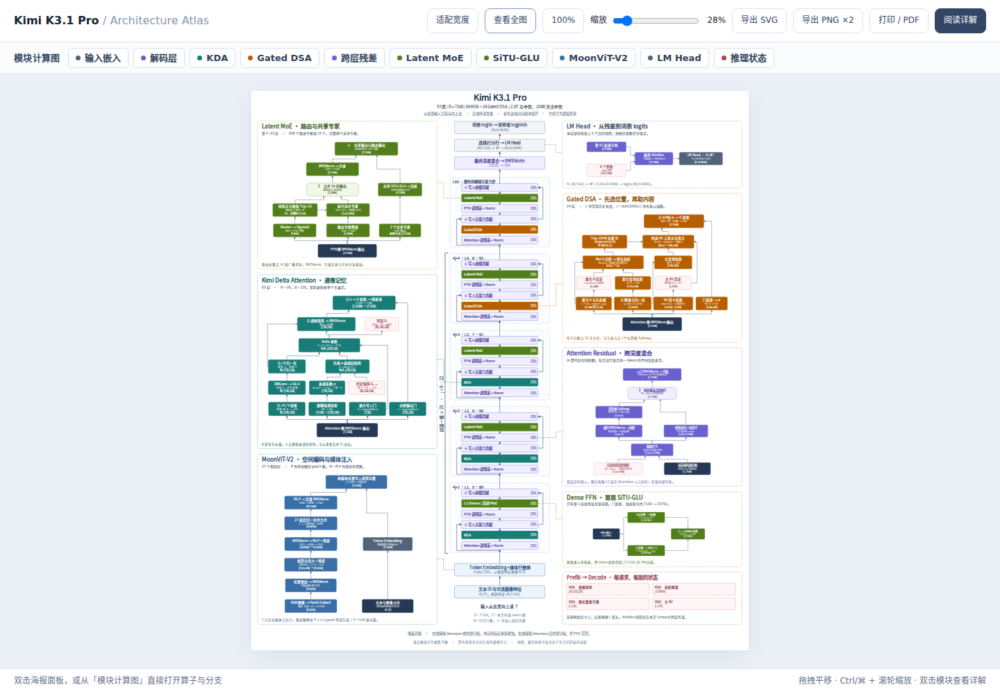

# 大模型架构与张量计算图谱

一个 Codex skill，用于把模型的真实层调度、逐模块前向计算和张量维度画成离线交互图谱。仓库随附 Kimi K3.1 Pro 的四层周期恢复版作为参考。



## 使用

将仓库克隆到个人 skills 目录。

```bash
git clone https://github.com/bupt-ycq/model-architecture-tensor-atlas.git "${CODEX_HOME:-$HOME/.codex}/skills/model-architecture-tensor-atlas"
```

调用示例：

```text
$model-architecture-tensor-atlas 请根据 <官方模型仓库> 生成中文架构图谱，保存到 <输出目录>。展开真实层周期、首末层例外和输出头，在每个模块图下附逐步维度表，并交付可重建工程。
```

[完整 skill 定义](SKILL.md) · [交互样张（下载后用浏览器打开）](references/kimi-k3.1-pro.html) · [KDA 递推示例](references/kda.png) · [LM Head 示例](references/lm-head.png)
